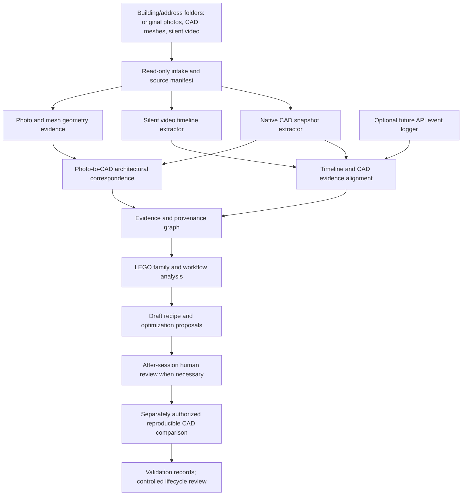

# Building Dataset Analyzer — Building Process Learning

Status update, 2026-11-04: **Phase 1 contract foundation implemented and non-CAD
tested** in [analyzer/](analyzer/README.md): Building Analysis/Source Manifest
0.1.0 schemas, read-only adapter interface, in-memory validation and synthetic
fixtures. No CAD extractor, event logger, pilot dataset, workflow executor or
trained model exists. No studio assets have been inspected or selected. Broader
capabilities below remain planned unless explicitly stated otherwise.

## Approved next phase — V0.1 read-only CAD Inspector

Strategic update, 2026-11-04: **prioritize Building Dataset Analyzer V0.1 before
completing the remaining architectural LEGO families**. The first deliverable is a
read-only SolidWorks CAD Inspector and structured JSON export, piloted on **three
existing studio building projects**. This supersedes the earlier balcony-first
schedule and 3–5-building/multimodal initial pilot. Photographs, 3MF/STL, silent OBS
recordings and the optional event logger remain later integrations, not prerequisites
for V0.1. Voice narration remains unnecessary in every phase.

Rationale: extract reusable structures and construction evidence across existing
buildings first, then use the findings to support concurrent development of balcony,
window, railing, stair, roof and other LEGO families. Do not require exhaustive
sequential completion of each family before learning from studio work. Parallel
family development is a subsequent product strategy, not implementation performed
or authorized by this phase-closing documentation task.

### V0.1 inputs, outputs and boundaries

- Inputs: explicitly selected native SLDPRT/SLDASM documents and accessible referenced
  parts for exactly three pilot building projects, organized by building/address.
  Record source revisions, configuration scope and missing references. Project paths
  and actual documents are not selected yet; do not scan studio folders implicitly.
- Inspector: extract the accessible feature hierarchy/types/suppression state,
  sketches/entities/relations, named dimensions and equations, feature and component
  dependencies, geometry summaries, solid bodies and feature/body relationships.
  For assemblies include component instances, transforms, reference resolution and
  configuration identity where accessible. Report unsupported relations/geometry
  rather than claiming complete recovery or guessing hidden history.
- Geometry summaries: declared units/coordinate frame, solid-body counts, measured
  bounds, volumes/areas and available topology/ownership. Label approximate bounds,
  extraction method and tolerances; do not present a mesh or approximation as exact
  native geometry. V0.1 need not serialize an entire boundary representation.
- Outputs: a versioned JSON schema, per-document/configuration inspection JSON,
  per-building source manifest, cross-project summary and limitations report.
  Derived artifacts live outside original studio folders. Phase 1 schemas and
  synthetic JSON fixtures exist; real exports, cross-project summary and inspector
  executable remain planned.
- Minimum JSON envelope: schema/tool version, run ID/time, source/building/document
  IDs and content hashes, source-relative references, configuration/environment,
  units, extraction coverage/status, entity records and dependency/body links.
  Per claim include observed/inferred/suggestion classification, source entity/path,
  extraction method, confidence with rationale, and evidence references. Missing
  values use null/unavailable plus a reason, never invented zero or success values.
- Candidate outputs: identify possible LEGO families/components and recipe fragments
  from native evidence, with source links, confidence, applicability and missing
  evidence. Approximate construction order inferred from the final feature graph
  remains an inference, not a recovered chronological modeling session. Every new
  recipe is **Draft**, even if its historical source model appears successful.
- Evaluation: produce an evidence-based rubric and candidate alternative strategies
  for parameterization, dependency quality, rebuild/reference robustness and
  profile-specific 3D-print manufacturing. Distinguish observed saved-state facts
  from predicted behavior. **Do not rebuild, edit parameters or execute optimized
  workflows during read-only inspection** to claim robustness; those comparisons
  require later authorized disposable fixtures and actual validation.
- Exclusions: production geometry changes, completing remaining LEGO variations,
  image matching, mesh ingestion, video chronology reconstruction, API event logging,
  model fine-tuning, automatic recipe promotion and physical print qualification.
  Broader module capabilities below are future work beyond this first CAD slice.

### V0.1 source-preservation contract

Establish an explicit adapter access strategy before CAD use. Read-only file opens
alone are not a guarantee against implicit rebuild/reference updates. Do not alter,
save, close, activate or change configurations of pre-existing user documents;
inspect saved source state through safe access or approved isolated copies. Never
rebuild, repair, migrate, relink, save or overwrite studio originals. Keep original
file hashes and referenced-file hashes unchanged; keep existing document dirty
flags unchanged. If this cannot be guaranteed, stop that extraction and report
the limitation; no writable fallback. Do not auto-launch SolidWorks. Actual future
CAD access and source selection must fall within the then-authorized task scope.

### V0.1 acceptance criteria

V0.1 is complete only when the following evidence is recorded; this document does
**not** assert that any of these implementation/pilot checks has run:

| Gate | Required evidence |
| --- | --- |
| Inspector separation | Dedicated read-only inspection path; existing geometry entry points, validated components and regression fixtures unchanged |
| Source preservation | Before/after hashes for every selected native source/reference; existing document dirty flags unchanged; no source writes/saves/rebuilds, no unintended document control; fail safely on inaccessible/unsafe assets |
| Extraction coverage | Feature tree, sketches, dimensions, geometry/solid bodies and dependencies exported for supported pilot inputs/configurations; per-category coverage, missing/suppressed/unresolved/unsupported items and reasons visible |
| JSON contract | Machine-validated versioned JSON; explicit units and frames, finite numeric values, stable entity IDs within source/configuration revisions, resolvable internal links and null-with-reason for unavailable facts |
| Provenance/confidence | Each extracted entity and derived claim traces to building, source digest, native document/configuration/entity, tool/method and evidence; fact/inference/suggestion and confidence rationale are distinct |
| Reproducibility | Reinspection of unchanged inputs produces equivalent normalized content and references; run timestamps/IDs are explicitly excluded from equality checks; no dependence on incidental COM enumeration order |
| Safe non-CAD tests | Synthetic fixtures for schema/serialization, units, dependency links, unavailable fields, source isolation, deterministic ordering, assembly-reference failure and Draft-only recipe handling; existing non-CAD regressions pass |
| Three-project pilot | Reports and JSON for **three distinct studio building projects**, chosen explicitly; review a declared sample of native feature/sketch/dimension/body/dependency records against source truth; document coverage and discrepancies for each project |
| Pilot failures | Any required missing category, mismatch or preservation failure is reported as partial/failed and resolved or explicitly narrowed by review before declaring V0.1 complete; inventory alone is not an extraction PASS |
| Cross-family knowledge | Traceable candidate-component/recipe inventory and comparison findings across families actually present in the three projects; absent families stay absent, no fabricated coverage or fixed recipe count |
| Alternative-strategy assessment | Findings distinguish static observed evidence from untested robustness/manufacturing hypotheses; each proposed optimization includes a later reproducible CAD validation plan, expected benefits and risks |
| Lifecycle and preservation | Discovered recipes remain Draft; later promotion requires applicable CAD/parameter/rebuild/manufacturing checks and required human review; existing scoped Validated releases and CAD baselines preserved |

Agree sampling, measurement tolerances, supported native versions/configurations
and printer-profile assumptions before pilot scoring. A partial project cannot be
silently substituted for a successful third project. V0.1 does not establish that
all architectural families, all native objects or every SolidWorks version work.

### Revised delivery sequence

1. Define the V0.1 JSON schema, source manifest, read-only adapter contract and
   synthetic extraction fixtures; select the compatible access method explicitly.
2. Implement the independent CAD Inspector and non-CAD checks; verify supported
   extraction and safe failure behavior before authorized studio intake.
3. Select three projects, run the authorized read-only pilot, audit sample records,
   and report per-project coverage, source preservation and reproducibility.
4. Extract Draft cross-family candidates and assess alternative strategies; use
   this knowledge to scope multiple LEGO family workstreams with validation gates.
5. Integrate original photographs, 3MF/STL and silent OBS recordings later, then
   optional event logging and more detailed Building Process Learning comparisons.

Current closeout status: documentation/strategy updated only. Inspector, schema,
native extraction and three-project pilot are **not implemented/not run**. No
SolidWorks execution, studio-file analysis or code changes occur in this closeout.

## Purpose and placement

Learn architectural construction workflows from silent SolidWorks recordings,
original building photographs, native SLDPRT/SLDASM documents and available 3MF/STL
exports. Recover structured, traceable knowledge and propose better construction
strategies. **Voice narration is never required.** Audio, if present, is optional
supplementary evidence; every pilot acceptance gate must work without it.

Building Dataset Analyzer collects and correlates evidence. Building Process
Learning interprets that evidence, compares recipes and proposes improvements.
They form a separate future module, outside the current console/COM bridge and
active balcony implementation. They may consume existing LEGO definitions and
validation reports; they must not silently alter executors or validated releases.

Roadmap order: **Building Dataset Analyzer V0.1 first**, then evidence-driven
development across multiple LEGO families, with later multimodal integration and
Building Process Learning. Remaining balcony variations are no longer a prerequisite.
The earlier sequential family-first priority is superseded; broader delivery goals
for the image-to-building pipeline and Golden Dataset remain planned. This document
does not establish that a Golden Dataset exists. Start with analysis and structured
knowledge extraction, **not model fine-tuning**.

## Proposed boundaries and flow

Each stage writes derived artifacts into a separate analysis workspace. Evidence
extraction, inference, proposal generation and CAD execution are distinct stages.
No automatically generated recipe or recording instruction becomes executable code.

| Boundary | Planned responsibility and outputs |
| --- | --- |
| Intake/catalog | Building IDs, address-folder mapping, asset inventory, hashes, references, units and missing-input report |
| Native CAD adapter | Feature/sketch/dimension snapshots, dependency and component/body graph, suppression/configuration state, extraction limitations |
| Silent video adapter | Frame/keyframe evidence, visible UI/text/selection changes, approximate operation intervals and uncertainty |
| Optional event logger | Sidecar events with timestamps and document/feature references to improve temporal matching |
| Alignment engine | Candidate links between video intervals, CAD entities, snapshots and logger events; confidence and alternatives |
| Architectural correspondence | Photo regions to CAD elements/views; camera/scale assumptions, occlusion and mismatches |
| Process learner | Workflow graph, LEGO families, reusable parameterized recipes, efficiency/robustness/manufacturing findings |
| Proposal reviewer | Draft alternatives, necessary short clarification queue, decisions and evidence links |
| Comparison harness adapter | Isolated original/optimized reconstruction fixtures, measured outcomes and reproducibility records |

Adapters expose capability/version information and explicit unsupported/unknown
fields. Installed SolidWorks/API versions, file compatibility, extraction access
and any license requirements must be checked in a future implementation phase;
do not assume one parser or API can recover every native object.

## Evidence extraction and correlation

### Native documents and exports

For each permitted native document/configuration, aim to extract named feature
types and parameters, sketches/entities/relations, driving versus driven dimensions,
equations, parent/child dependencies, suppression states, component transforms,
assembly references and mates where available. Record feature-to-body ownership,
merge/cut targets, body connectivity and geometry measurements with units. Separate
document extraction failures from absent geometry. Resolve assembly references
explicitly; missing parts/configurations remain missing, not guessed replacements.

Store native references plus extraction-time entity descriptors and geometry
signatures. Feature names alone are not globally unique; identity includes source
digest, document/configuration, feature path and extraction revision. A feature tree
is a dependency/history artifact, **not proof of the full chronological session**:
deleted operations, retries and intermediate states may be unrecoverable.

Mesh adapters record 3MF/STL contents as available, including transform/scale and
unit provenance, bounds, connectivity, topology and mesh defects. Unknown units
remain unresolved; never silently interpret them as miniature millimeters. Meshes
cannot be treated as proof of parametric sketches, CAD feature history or editability.
No automatic source repair, conversion or replacement. Photo/CAD/mesh revisions
must be matched through evidence, not just filenames or proximity in a folder.

### Silent recordings and optional events

Segment the recording into approximate modeling operations using visible command
panels, feature-tree edits, sketches, dimension entry and viewport/geometry changes.
Keep playback-only actions (zoom, pan, rotate), pauses, undo/redo, dialogs and failed
attempts distinct from committed CAD features. Record multiple plausible operation
sequences when the UI is hidden, clipped, too fast or ambiguous.

Video time is an interval in a declared media timebase, not an invented exact CAD
timestamp. Align visible feature names/dimensions, body counts, shape changes and
dependency constraints to native snapshots. Final CAD plus video can support an
approximate partial-order workflow; it cannot guarantee exact intermediate geometry
or capture every action. Missing events and uncertainty must survive downstream.

An optional future SolidWorks API logger can observe command/feature/document,
dimension, rebuild, undo/redo and save events **where the API supports them**.
It writes a sidecar outside studio files, with session/document IDs, sequence
numbers, wall-clock and monotonic timestamps, units, event payload/version and any
permitted snapshot references. Record clock offsets/drift, OBS start alignment,
recording pauses and dropped events. Align by anchors with residual timing error;
do not equate wall-clock time with video time or assume every UI action emits an
event. The logger must not issue modeling commands or require a narrated session.
Its use and any SolidWorks access require future explicit authorization.

### Photographs and architectural intent

Map photo regions to CAD components and relevant model views. Record perspective,
camera pose, orientation, scale evidence, occlusion and confidence. Compare facade
proportions, openings, floor/bay repetition, projections and visible details while
distinguishing intended miniature simplification and print-driven dimensional
adjustments from discrepancies. A mesh or perspective photograph does not establish
hidden dimensions or exact depth. Use architectural mm, miniature mm and COM meters
as separately identified quantities, consistent with existing LEGO contracts.

## Knowledge records and provenance

Proposed storage: versioned structured manifests/records (initially JSON and
JSONL plus readable reports), with schemas introduced during implementation.
An evidence graph links records by IDs; a graph database is not a prerequisite.
Phase 1 schemas implement the native-CAD subset of these contracts. Operations,
comparisons, reviews and multimodal services remain future work. Exact implemented
fields/limitations are in [analyzer/README.md](analyzer/README.md).

| Record | Minimum fields |
| --- | --- |
| Building | Stable building ID, address/folder alias, source revision, asset IDs; keep private source locations out of portable public records |
| Asset | ID, building ID, kind, source-relative path/root alias, digest, size, units/timebase, native configuration or media metadata, ingestion/version |
| CAD entity/snapshot | Asset digest, document/configuration, feature/sketch/body/component reference, dimensions and dependencies, geometry signature, extraction tool/version and coverage |
| Operation | ID, action/type, entity links, video start/end interval and frames, before/after snapshot references if available, optional event IDs, uncertainty and ordering constraints |
| Claim | Statement, classification, confidence/rationale, supporting/contradictory evidence IDs, alternatives and unresolved questions |
| Component/recipe proposal | Building/photo-region/CAD-entity/operation links, LEGO family, candidate ID/version, parameter rules, applicability, dependencies, lifecycle **Draft** and validation needs |
| Comparison | Original/proposed recipe digests, input/dependency locks, environment, tolerances, repeated run IDs, measurements, failures and review outcome |
| Review | Target IDs/digests, short question if required, response/approval scope, reviewer and timestamp; never overwrite the source observations |

Every extracted component or recipe must trace to its building and available photo
regions, CAD entities, recording time intervals and source digests. For an older
building with no video, or a feature invisible in photographs, store the link as
**unavailable/not applicable with reason**, never fabricate timestamps or regions.
Transitive provenance is allowed, but consumers must be able to traverse it back
to the actual asset/version. Re-analysis creates a new result revision, preserving
earlier claims and the evidence/tool versions used to derive them.

Claims have explicit classes:

- **Observed fact:** directly supported by identified frames, native extraction,
  events or measurements, with coverage/measurement limits.
- **Inferred intention:** a proposed explanation of purpose or ordering, with
  confidence, alternatives and supporting/contradictory observations.
- **Unverified optimization suggestion:** a proposed alternative, anticipated
  benefits/risks and required checks; never reported as a demonstrated improvement.

Claim confidence is separate from lifecycle status. Human agreement with an
inference does not turn an unexecuted optimization into validated geometry.

## Learning and evaluating alternatives

Classify structural, opening, architectural and secondary-detail families using
the [LEGO contracts](ARCHITECTURAL_LEGO_V1.md). Extract reusable anchors, dimensions,
dependencies and body/print-group policies rather than copying cursor movements.
Separate a historical workaround, modeling error, stylistic choice and reusable
constraint when evidence permits; otherwise preserve the ambiguity.

Compare shared profiles, grouped operations, separate bosses, patterns/mirrors,
datums and other supported alternatives where relevant. Historical methods are
evidence, not obligatory templates. Preserve intent, geometry and manufacturability;
fewer features alone do not establish a better recipe. The scoped balcony
shared-sketch release is an example of an evidence-backed comparison, not a rule
to apply to all buildings or unequal-height/parapet configurations.

Evaluation dimensions include:

- Efficiency: operation/feature complexity, repeated work, retries and timing;
  distinguish recording pauses from modeling time and use comparable environments.
- Parameterization: meaningful editable dimensions, host references, dependency
  propagation and unsupported edit domains.
- Robustness: rebuild results, reference stability, failed/ambiguous operations,
  repeatability and controlled parameter-edit tests.
- Manufacturing: minimum sections, connected print groups, unwanted merges/cuts,
  mesh integrity, intended orientation, clearances and profile-specific limits.
  Separate analytic/CAD checks from physical print qualification.

Reproducible comparisons use frozen original evidence and **separate disposable
working copies or reconstructed test parts**, never studio originals. Pin source,
recipe and dependency digests, units/scaling, environment, printer-profile inputs,
fixture edits, tolerances and measurement versions. Compare original versus
optimized geometry, component intent, dimensions, volume, body scope/connectivity,
edit propagation, rebuilds and failures before efficiency claims. If the original
workflow cannot be reconstructed, compare to its final geometry but mark workflow
equivalence/timing as unverified. Preserve failed runs. CAD execution is a separate
approved phase; a plausible proposal is not a passing comparison.

All newly proposed LEGO recipes enter the candidate store as **Draft**. A later,
controlled review may move an exact version to Testing and then scoped Validated
only after applicable reproducible checks and required human approval. Analysis,
logger events or automatic scoring never register a recipe as Validated. Existing
validated versions and their regression evidence remain immutable.

## Human review and source preservation

Do not interrupt a silent modeling session with narration requests or analysis
questions. Queue only consequential unresolved items; after the session ask a
short clarification/approval tied to a component or time interval when evidence
cannot resolve intent or a decision affects acceptance. Group related questions
and allow unknown/deferred answers. Continue independent analysis without treating
silence as approval. Routine observations need no human confirmation. Future CAD
comparison approval remains required when the task has not already authorized it.

Analyze studio assets **read-only**. Catalog originals in place and write reports,
derived images/meshes, caches and logs to a separate workspace. Verify source hashes
before/after future intake/extraction; never save, rebuild, repair, migrate, relink
or overwrite originals. If safe extraction requires opening/rebuilding a model,
use a separately authorized working copy with preserved assembly references and
report any resulting derived-state changes. Do not silently fall back to writable
source access. Source unavailability or incompatible versions produce a limitation
report. No upload/publication of studio assets is implied by the pilot.

## Later multimodal pilot and implementation phases

The earlier expanded pilot target remains a **later option, not V0.1 scope**:
**3–5 existing studio buildings**, each grouped by building/address
folder with original photographs, native CAD and available 3MF (STL also accepted).
Missing optional exports or recordings are recorded explicitly. Add **one silent
OBS recording of a new modeling session**, associated with a pilot building/revision
where practicable. Selection, paths and recording setup remain future work; no
studio folder is assumed to have been provided or inspected.

| Phase | Planned work | Exit evidence |
| --- | --- | --- |
| A0 — Pilot contract | Select the 3–5 buildings when authorized; agree source aliases, schemas, review rules and artifact/unit conventions | Approved inventory plan and fixtures; no assumption assets are complete |
| A1 — Read-only catalog | Implement manifests, content hashes and photo/native/mesh association; list assembly dependencies and missing assets | Reproducible inventory, unchanged original hashes, explicit coverage/missing-input report |
| A2 — Structured extraction | Native snapshots plus photo/mesh metadata and geometry; adapter capability checks | Traceable entity/dimension/body/dependency records, unit checks, unsupported-field records and extractor fixtures |
| A3 — Silent timeline | Process the OBS session, segment visible actions, align with CAD/photo evidence | Human-auditable approximate operation graph with time intervals, uncertainty and no audio dependency |
| A3b — Optional event logger | Add non-mutating API observation and clock alignment after the video-only path works | Event/video alignment error and dropped-event report; pipeline still works without logger |
| L1 — Process knowledge | Identify LEGO families, parameter rules, workflow findings, clarification queue and Draft alternatives across pilot buildings | Provenance-complete structured knowledge and review outcomes; no fine-tuning or automatic validation |
| L2 — Controlled comparisons | Prepare original/optimized fixtures, then run only authorized isolated CAD comparisons | Repeatable measurements, edit/rebuild/manufacturing results, failures and explicit human acceptance scope |
| L3 — Reviewed knowledge reuse | Curate versioned recipes and reviewed learning rules; integrate eligible knowledge with future library/image pipeline | Controlled lifecycle records and applicability limits; no silent replacement of validated definitions |

The V0.1 sequence and acceptance gates above take priority over this broader phase
table. The table preserves the later multimodal/process-learning design; it does not
require a recording, photographs or exports before the three-project native-CAD
pilot. Begin with V0.1 schema/manifest and synthetic fixtures, then the inspector
and authorized pilot. Logger attachment and actual optimization CAD comparisons
remain separately scoped future work. Fine-tuning remains outside the initial plan.

## Initial verification strategy and open decisions

Future automated checks should cover manifest determinism, path/source isolation,
hash preservation, unresolved units, missing assembly references, complete provenance,
timestamp/clock gaps, fact/inference/suggestion separation and Draft-only registration.
Use synthetic/golden extraction fixtures before studio intake. For the pilot,
manually annotate a small set of silent-video actions/alignments to measure coverage,
operation classification and timing error; agree tolerances before scoring results.
Keep extraction accuracy distinct from proposed-recipe CAD correctness.

Open decisions: actual pilot selection/permissions, native extraction APIs and
supported versions, assembly dependency resolution, scale/camera calibration,
logger event coverage, operation taxonomy, timing/geometry tolerances, printer
profiles, retention/access policy and a future review interface. Missing evidence
must be reported instead of invented. No performance, extraction accuracy, build,
CAD validation or physical-print results are claimed for this planned module.
